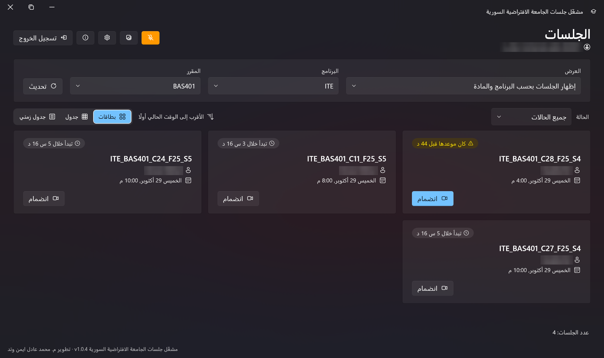
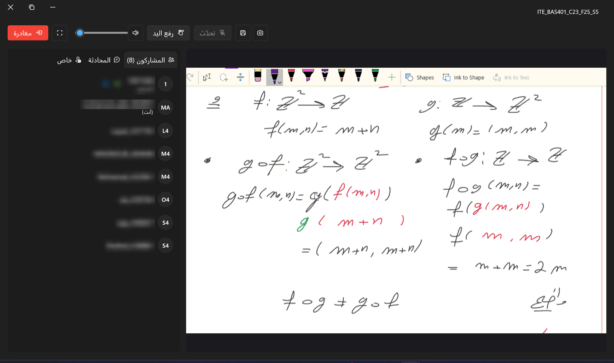

<h1 align="center">SVU Launcher</h1>

<p align="center">
  <strong>مشغّل جلسات الجامعة الافتراضية السورية</strong><br>
  <sub>A lightweight Windows launcher for SVU live lectures</sub>
</p>

<p align="center">
  
  
  
  
  
  
</p>

<p align="center">
  <a href="#ar">العربية</a> · <a href="#en">English</a>
</p>

<p align="center">
  <strong>Developer:</strong> Eng. Mohammad Adel Ayman Watad ·
  <a href="https://wa.me/963988038382">WhatsApp +963 988 038 382</a>
</p>

> ⚠️ **Independent project / مشروع مستقل**
>
> SVU Launcher is an independent, non-official project. It is **not affiliated with, endorsed by,
> or operated by the Syrian Virtual University administration**. The university’s name is used only
> to describe compatibility with its lecture services.
>
> هذا المشروع مستقل وغير رسمي، وليس تابعًا لإدارة الجامعة الافتراضية السورية ولا ممثلًا عنها.
> يُستخدم اسم الجامعة فقط لوصف التوافق مع خدمات المحاضرات.

---

<a id="ar"></a>

# 🇸🇾 العربية

دليل عملي لتثبيت **SVU Launcher** وتفعيله والبدء باستخدامه على Windows. أحدث إصدار:
`v1.0.7`.

> **حمّل فقط من [صفحة أحدث إصدار رسمي](../../releases/latest):** لا تثق بملفات Setup من مصادر أخرى.
> لا تشارك مفتاح الترخيص أو كلمة مرور الجامعة مع أي شخص.

## المحتويات

- [نظرة عامة](#ar-overview)
- [متطلبات التشغيل](#ar-requirements)
- [الخطوة 1: التنزيل والتحقق](#ar-step-1)
- [الخطوة 2: التثبيت السريع](#ar-step-2)
- [الخطوة 3: التشغيل الأول وطلب الترخيص](#ar-step-3)
- [الخطوة 4: التفعيل](#ar-step-4)
- [الخطوة 5: تسجيل الدخول وبدء المحاضرة](#ar-step-5)
- [دليل التثبيت والتشغيل على نظام لينكس](#ar-linux)
- [الدعم والتواصل](#ar-support)
- [الخصوصية والترخيص](#ar-privacy)

<a id="ar-overview"></a>

## نظرة عامة

**SVU Launcher** تطبيق سطح مكتب خفيف لطلاب الجامعة الافتراضية السورية. يجمع تسجيل الدخول إلى
حساب الجامعة، واستعراض البرامج والمواد والجلسات، والانتقال إلى قاعة المحاضرة في مكان واحد.

- واجهة عربية وإنجليزية مع دعم كامل للاتجاه من اليمين إلى اليسار.
- تثبيت لكل مستخدم دون الحاجة إلى صلاحيات مدير Windows.
- تفعيل بترخيص مرتبط بالجهاز، مع تحقق دوري من الخادم.
- تخزين آمن لبيانات الحساب باستخدام DPAPI.
- إصدار x64 قائم بذاته، لا يحتاج إلى تثبيت .NET بشكل منفصل.

> **Linux:** تتوفّر نسخة أصلية لنظام Linux بصيغة **AppImage** مبنية على إطار Avalonia، بتكافؤ وظيفي
> كامل مع نسخة Windows: تسجيل الدخول واستعراض الجلسات والتفعيل وقاعة المحاضرة (الصوت ومشاركة الشاشة
> والمحادثة) والتحديث الذاتي وأربع سمات (Fluent، Semi، Suki، Material). راجع
> [دليل التثبيت والتشغيل على نظام لينكس](#ar-linux) خطوة بخطوة أدناه.

> يُنصح دائمًا بالاحتفاظ بنسخة من مفتاح الترخيص في مكان آمن.

<a id="ar-requirements"></a>

## متطلبات التشغيل

| المتطلب | التفاصيل |
|---|---|
| نظام التشغيل | Windows 10 أو Windows 11 |
| المعمارية | 64-bit / x64 |
| الاتصال | اتصال بالإنترنت عند التفعيل وعند التحقق الدوري |
| الحساب | حساب جامعي فعّال |
| الترخيص | مفتاح تفعيل بصيغة `SVUL-XXXXX-XXXXX-XXXXX-XXXXX` |
| اختياري | سماعات أو ميكروفون لحضور المحاضرات الصوتية |

<a id="ar-step-1"></a>

## الخطوة 1: التنزيل والتحقق

1. افتح [صفحة أحدث إصدار](../../releases/latest) في هذا المستودع.
2. نزّل أحدث ملف `Setup.exe` الخاص بـ **SVU Launcher**.
3. تحقق من أن الملف قادم من صفحة الإصدارات الرسمية، وليس من رابط خارجي.
4. إذا ظهر تحذير من Windows SmartScreen، فتأكد أولًا من مصدر الملف. لا تتجاوز التحذير إلا إذا
   كنت واثقًا من أن التنزيل رسمي.

<a id="ar-step-2"></a>

## الخطوة 2: تثبيت خفيف دون صلاحيات مدير

1. شغّل ملف `Setup.exe`.
2. اتبع معالج التثبيت.
3. يمكنك تغيير مجلد التثبيت من صفحة اختيار المجلد.
4. اترك خيار **إنشاء اختصار على سطح المكتب** مفعّلًا إن رغبت.
5. أكمل التثبيت. لا يحتاج الطالب عادةً إلى صلاحيات مدير؛ التثبيت الافتراضي يكون لحساب المستخدم.

<a id="ar-step-3"></a>

## الخطوة 3: التشغيل الأول وطلب الترخيص

1. شغّل **SVU Launcher** من سطح المكتب أو قائمة ابدأ.
2. افتح صفحة **الترخيص** أو **الإعدادات ← الترخيص**.
3. ابحث عن معرّف الجهاز، ويظهر عادةً بالشكل: `This PC: 7794-2663`.
4. أرسل إلى المطوّر عبر واتساب:
   - الاسم الكامل.
   - معرّف الجهاز / Machine Fingerprint.
   - أي ملاحظة عن مشكلة التفعيل إن وجدت.
5. لا ترسل كلمة مرور الجامعة أو أي بيانات حساسة.

> **ملاحظة:** مفتاح الترخيص مرتبط بجهاز واحد. إذا غيّرت الجهاز أو أعدت تثبيت Windows، تواصل مع
> الدعم قبل محاولة تفعيل المفتاح على جهاز آخر.

<a id="ar-step-4"></a>

## الخطوة 4: التفعيل

1. بعد استلام المفتاح، الصقه في حقل **مفتاح الترخيص**.
2. اضغط **تفعيل**.
3. تأكد من ظهور الحالة **فعّال** مع تاريخ انتهاء الاشتراك.
4. يعمل التطبيق دون اتصال ضمن مهلة الترخيص المؤقتة، ثم يتحقق من الخادم دوريًا. أبقِ الجهاز متصلًا
   بالإنترنت بين الحين والآخر لتجديد التحقق.

صيغة المفتاح:

```text
SVUL-XXXXX-XXXXX-XXXXX-XXXXX
```

> إذا ظهرت رسالة **«أدخل مفتاحًا صحيحًا»**، تحقق من عدم وجود مسافات إضافية ومن أن المفتاح مخصص
> لهذا الجهاز. إذا استمرت المشكلة، أرسل صورة للخطأ إلى الدعم.

<a id="ar-step-5"></a>

## الخطوة 5: تسجيل الدخول وبدء المحاضرة

1. سجّل الدخول باسم المستخدم وكلمة مرور الجامعة.
2. اختر البرنامج أو المادة من القائمة.
3. استعرض الجلسات الظاهرة، مع حالتها ووقتها واسم المدرّس.
4. اضغط **بدء الجلسة** أو زر الدخول إلى المحاضرة.
5. انتظر تحميل قاعة المحاضرة، ثم استخدم أدوات الصوت والمحادثة والمشاركة حسب ما يتيحه المدرّس.

<p align="center">
  
</p>
<p align="center"><sub>الخطوة 5أ — اختر البرنامج أو المادة ثم اعرض الجلسات المتاحة.</sub></p>

<p align="center">
  
</p>
<p align="center"><sub>الخطوة 5ب — بدء قاعة المحاضرة والانضمام إليها.</sub></p>

> **نصيحة:** استخدم سماعات لتقليل الصدى، وتأكد من إعدادات الميكروفون قبل رفع اليد أو التحدث.

<a id="ar-linux"></a>

## دليل التثبيت والتشغيل على نظام لينكس

تتوفّر نسخة Linux بصيغة **AppImage**: ملف واحد قائم بذاته يعمل على معظم التوزيعات الحديثة بنواة
64-bit دون أي خطوة تثبيت. يتضمّن الملف بيئة تشغيل .NET الخاصة به، لذا **لا تحتاج** إلى تثبيت .NET أو
أي إطار آخر. وهي نسخة رسمية للإنتاج بتكافؤ وظيفي كامل مع نسخة Windows: تسجيل الدخول واستعراض الجلسات
والتفعيل وقاعة المحاضرة (الصوت ومشاركة الشاشة والمحادثة) والتحديث الذاتي والسمات الأربع (Fluent و Semi
و Suki و Material) تعمل جميعها.

> إجراءات طلب الترخيص والتفعيل وصيغة المفتاح مطابقة تمامًا لنسخة Windows — راجع [الخطوة 3](#ar-step-3)
> و [الخطوة 4](#ar-step-4). للمساعدة، تواصل مع المطوّر عبر [واتساب](https://wa.me/963988038382).

### 1. متطلبات النظام

يعمل التطبيق على أي سطح مكتب شائع (GNOME و KDE و XFCE و Cinnamon …) سواء على **X11 أو Wayland**. على
Wayland يعمل التطبيق تلقائيًا عبر XWayland. يجب توفّر ثلاثة مكوّنات:

| المكوّن | سبب الحاجة إليه | مثبّت مسبقًا عادةً؟ |
|---|---|---|
| **FUSE 2** (`libfuse2`) | يتيح لملف AppImage تحميل نفسه وتشغيله | غالبًا غير موجود على الأنظمة الجديدة |
| **PulseAudio أو PipeWire** | صوت المحاضرة دخولًا وخروجًا من القاعة | نعم، على أي سطح مكتب |
| **X11 / XWayland** + fontconfig | النافذة والرسوم وعرض النصوص | نعم، على أي سطح مكتب |

عمليًا، الحزمة الوحيدة التي قد تحتاج إلى إضافتها هي **FUSE 2**. التوزيعات الأحدث (2023 وما بعدها)
تأتي غالبًا بـ **FUSE 3** فقط؛ ثبّت حزمة توافق FUSE 2 أدناه، أو تجاوز FUSE تمامًا باستخدام
[التشغيل دون FUSE](#ar-linux-nofuse).

### 2. تثبيت المتطلبات

**Debian · Ubuntu · Linux Mint · Pop!_OS**

```bash
sudo apt update
sudo apt install -y libfuse2 libfontconfig1 libx11-6 libicu-dev
# في Ubuntu 24.04 وما بعده يكون اسم حزمة FUSE 2 هو libfuse2t64 بدلًا من libfuse2.
```

**Arch · Manjaro · EndeavourOS**

```bash
sudo pacman -S --needed fuse2 fontconfig libx11 icu
```

**Fedora · RHEL · Nobara**

```bash
sudo dnf install -y fuse fuse-libs fontconfig libX11 libicu
```

> الصوت (PipeWire/PulseAudio) و XWayland يأتيان مع كل صورة سطح مكتب قياسية، لذا وردا أعلاه من أجل
> الأنظمة المصغّرة أو بلا واجهة فقط. على نظام GNOME أو KDE اعتيادي، عادةً ما تكون FUSE 2 هي الإضافة
> الوحيدة اللازمة.

### 3. تنزيل ملف AppImage

نزّل أحدث إصدار مباشرةً من صفحة الإصدارات إلى مجلد قابل للكتابة:

```bash
mkdir -p ~/Applications
wget -O ~/Applications/SvuSessionsLauncher.AppImage \
  https://github.com/adel5000/SvuLauncher/releases/latest/download/SvuSessionsLauncher.AppImage
```

أو افتح [صفحة أحدث إصدار](../../releases/latest) في المتصفّح ونزّل `SvuSessionsLauncher.AppImage`.
الاحتفاظ به في مكان قابل للكتابة مثل `~/Applications` هو ما يتيح له
[تحديث نفسه لاحقًا](#ar-linux-updates).

### 4. منحه صلاحية التنفيذ وتشغيله

```bash
chmod +x ~/Applications/SvuSessionsLauncher.AppImage
~/Applications/SvuSessionsLauncher.AppImage
```

تفتح نافذة تسجيل الدخول. من هنا، اطلب مفتاح الترخيص وأدخله تمامًا كما في Windows
([الخطوة 3](#ar-step-3) و [الخطوة 4](#ar-step-4))، ثم سجّل الدخول واستعرض جلساتك
([الخطوة 5](#ar-step-5)).

<a id="ar-linux-nofuse"></a>

#### التشغيل دون FUSE

إذا ظهر خطأ مثل `dlopen(): error loading libfuse.so.2` أو `fuse: failed to exec fusermount`، فإمّا
أن تثبّت FUSE 2 (القسم 2)، أو تشغّل الملف عبر استخراجه آنيًا دون الحاجة إلى FUSE:

```bash
~/Applications/SvuSessionsLauncher.AppImage --appimage-extract-and-run
```

### 5. إضافته إلى قائمة التطبيقات

أنشئ مدخل سطح مكتب ليظهر SVU Launcher في قائمتك مع أيقونته. تنسخ الأوامر التالية الأيقونة من داخل
ملف AppImage، ثم تكتب ملف `.desktop` قياسيًا:

```bash
cd ~/Applications

# استخراج الأيقونة المضمّنة مرة واحدة.
./SvuSessionsLauncher.AppImage --appimage-extract >/dev/null
mkdir -p ~/.local/share/icons ~/.local/share/applications
cp squashfs-root/.DirIcon ~/.local/share/icons/svulauncher.png 2>/dev/null
rm -rf squashfs-root

# كتابة مدخل المشغّل.
cat > ~/.local/share/applications/svulauncher.desktop <<EOF
[Desktop Entry]
Type=Application
Name=SVU Launcher
Comment=Syrian Virtual University live lectures
Exec=$HOME/Applications/SvuSessionsLauncher.AppImage
Icon=svulauncher
Terminal=false
Categories=Education;Network;
EOF

update-desktop-database ~/.local/share/applications 2>/dev/null || true
```

سيظهر SVU Launcher الآن في قائمة التطبيقات ويمكن البحث عنه بالاسم.

> **تفضّل الدمج التلقائي؟** ثبّت **AppImageLauncher** (`sudo apt install appimagelauncher` على
> Debian/Ubuntu، أو من توزيعتك أو من
> [إصداراته على GitHub](https://github.com/TheAssassin/AppImageLauncher/releases)). عند فتح أي ملف
> AppImage يعرض عليك نقله إلى `~/Applications` وإضافة مدخل القائمة والأيقونة نيابةً عنك — دون الحاجة
> إلى ملف `.desktop` يدوي.

<a id="ar-linux-updates"></a>

### 6. التحديث الذاتي

يحدّث التطبيق نفسه تلقائيًا — لا حاجة لإعادة التنزيل مع كل إصدار:

1. افتح **الإعدادات** واختر **التحقق من التحديثات** (كما يتحقق بهدوء في الخلفية عند بدء التشغيل).
2. عند توفّر إصدار أحدث، يُنزَّل ويُطبَّق في مكانه؛ أعد تشغيل التطبيق لإتمام التحديث.

لكي يعمل التحديث في مكانه، يجب أن يوجد ملف AppImage في مجلد قابل للكتابة (مثل `~/Applications`، وليس
مجلد نظام للقراءة فقط). إذا دمجته عبر AppImageLauncher فهذا متحقق أصلًا.

> **بديل التحديث اليدوي:** يمكنك دائمًا إعادة تنزيل أحدث ملف AppImage (القسم 3) واستبدال الملف
> القديم. يُحفظ الترخيص والحسابات المحفوظة والإعدادات ضمن `~/.local/share/SvuLauncher` وتبقى عبر
> التحديثات.

<a id="ar-support"></a>

## الدعم والتواصل

**المطوّر:** Eng. Mohammad Adel Ayman Watad

- واتساب: [+963 988 038 382](https://wa.me/963988038382)
- عند طلب الدعم، أرسل:
  - اسمك الكامل.
  - معرّف الجهاز `This PC: XXXX-XXXX`.
  - وصفًا قصيرًا للمشكلة.
  - لقطة شاشة للخطأ إن أمكن.

> **لا ترسل كلمة مرور الجامعة أبدًا.** لا يطلب المطوّر كلمة المرور لتفعيل الترخيص.

<a id="ar-privacy"></a>

## الخصوصية والترخيص

- تُخزّن بيانات الحساب المحفوظة محليًا باستخدام DPAPI.
- الترخيص مرتبط بجهاز واحد، ويتم التحقق منه دوريًا عبر خادم الترخيص.
- التطبيق لا يرسل بيانات حسابك إلى خادم الترخيص.
- لا تشارك مفتاح الترخيص علنًا؛ يمكن إلغاؤه أو إعادة ضبطه من لوحة الإدارة.

---

<a id="en"></a>

# 🇬🇧 English

A practical guide to installing, activating, and using **SVU Launcher** on Windows. The latest
release is `v1.0.7`.

> **Download only from the official [latest release page](../../releases/latest).** Do not trust
> Setup files from other sources. Never share your licence key or your university password.

## Contents

- [Overview](#en-overview)
- [Requirements](#en-requirements)
- [Step 1: Download and verify](#en-step-1)
- [Step 2: Lightweight installation](#en-step-2)
- [Step 3: First launch and licence request](#en-step-3)
- [Step 4: Activation](#en-step-4)
- [Step 5: Student login and session launch](#en-step-5)
- [Linux installation & setup guide](#en-linux)
- [Support](#en-support)
- [Privacy and licensing](#en-privacy)

<a id="en-overview"></a>

## Overview

**SVU Launcher** is a lightweight Windows desktop launcher for students of the Syrian Virtual
University. It brings together university sign-in, program and course browsing, session discovery,
and lecture-room hand-off in one focused app.

- Arabic and English UI with proper right-to-left layout.
- Per-user installation with no Windows Administrator requirement.
- PC-bound licence activation with periodic server validation.
- DPAPI-protected storage for saved account credentials.
- Self-contained x64 build; no separate .NET installation is required.

> **Linux:** A native Linux build is available as an **AppImage**, built on the Avalonia framework, at
> full parity with the Windows version: sign-in, session browsing, activation, the live lecture room
> (voice, screen share, and chat), self-update, and four UI themes (Fluent, Semi, Suki, Material). See
> the step-by-step [Linux installation & setup guide](#en-linux) below.

> Always keep a copy of your licence key in a safe place.

<a id="en-requirements"></a>

## Requirements

| Requirement | Details |
|---|---|
| Operating system | Windows 10 or Windows 11 |
| Architecture | 64-bit / x64 |
| Connection | Internet access for activation and periodic licence checks |
| Account | An active SVU university account |
| Licence | A serial key in the form `SVUL-XXXXX-XXXXX-XXXXX-XXXXX` |
| Optional | Headphones or a microphone for voice lectures |

<a id="en-step-1"></a>

## Step 1: Download and verify

1. Open this repository’s [latest release page](../../releases/latest).
2. Download the latest **SVU Launcher** `Setup.exe`.
3. Confirm that the file came from the official Releases page, not an external link.
4. If Windows SmartScreen shows a warning, verify the file source first. Do not bypass the warning
   unless you are certain the download is official.

<a id="en-step-2"></a>

## Step 2: Lightweight installation

1. Run `Setup.exe`.
2. Follow the installation wizard.
3. You can change the installation folder on the directory page.
4. Leave **Create a desktop shortcut** enabled if you want one.
5. Finish the installation. Students normally do not need Administrator rights; the default install
   is per-user.

<a id="en-step-3"></a>

## Step 3: First launch and licence request

1. Launch **SVU Launcher** from the desktop or Start Menu.
2. Open the **Licence** page or **Settings → Licence**.
3. Find the machine fingerprint, usually shown as: `This PC: 7794-2663`.
4. Send the developer a WhatsApp message with:
   - Your full name.
   - The machine fingerprint / PC ID.
   - A short note if activation is failing.
5. Do not send your university password or any sensitive account data.

> **Note:** A licence key is bound to one PC. If you change computers or reinstall Windows, contact
> support before trying to activate the same key on another machine.

<a id="en-step-4"></a>

## Step 4: Activation

1. Paste the key you received into the **Licence key** field.
2. Press **Activate**.
3. Confirm that the status becomes **Active** and that the subscription expiry is shown.
4. The app works offline within its lease window and checks back with the licence server periodically.
   Keep the PC online from time to time so the lease can be refreshed.

Serial format:

```text
SVUL-XXXXX-XXXXX-XXXXX-XXXXX
```

> If you see **“This key has a typo”**, check for extra spaces and make sure the key belongs to this
> PC. If the problem continues, send a screenshot of the error to support.

<a id="en-step-5"></a>

## Step 5: Student login and session launch

1. Sign in with your SVU username and password.
2. Choose a program or course from the list.
3. Review the available sessions, including status, time, and tutor name.
4. Press **Start session** or the lecture entry button.
5. Wait for the lecture room to load, then use the voice, chat, and sharing controls the tutor makes
   available.

<p align="center">
  
</p>
<p align="center"><sub>Step 5a — Choose a program or course and browse the available sessions.</sub></p>

<p align="center">
  
</p>
<p align="center"><sub>Step 5b — Launch the lecture room and join the session.</sub></p>

> **Tip:** Use headphones to reduce echo, and check your microphone settings before raising your hand
> or speaking.

<a id="en-linux"></a>

## Linux installation & setup guide

The Linux build ships as a single **AppImage**: one self-contained file that runs on most modern
64-bit distributions with no installation step. It bundles its own .NET runtime, so you do **not**
need to install .NET or any other framework. It is a first-class, production release at full parity
with the Windows version: sign-in, session browsing, activation, the live lecture room (voice, screen
share, and chat), self-update, and the four UI themes (Fluent, Semi, Suki, Material) all work.

> Licence requests, activation, and the serial format are identical to the Windows version — see
> [Step 3](#en-step-3) and [Step 4](#en-step-4). For help, message the developer on
> [WhatsApp](https://wa.me/963988038382).

### 1. System prerequisites

Any mainstream desktop (GNOME, KDE, XFCE, Cinnamon, …) on **X11 or Wayland** works. On Wayland the
app runs automatically through XWayland. Three components must be present:

| Component | Why it is needed | Usually preinstalled? |
|---|---|---|
| **FUSE 2** (`libfuse2`) | Lets the AppImage mount and run itself | Often missing on new installs |
| **PulseAudio or PipeWire** | Lecture audio, into and out of the room | Yes, on any desktop |
| **X11 / XWayland** + fontconfig | Window, graphics, and text rendering | Yes, on any desktop |

In practice, the only package most users need to add is **FUSE 2**. Newer distributions (2023 and
later) often ship **FUSE 3** only; install the FUSE 2 compatibility package below, or skip FUSE
altogether with the [extract-and-run fallback](#en-linux-nofuse).

### 2. Install the prerequisites

**Debian · Ubuntu · Linux Mint · Pop!_OS**

```bash
sudo apt update
sudo apt install -y libfuse2 libfontconfig1 libx11-6 libicu-dev
# Ubuntu 24.04 and newer: the FUSE 2 package is named libfuse2t64 instead of libfuse2.
```

**Arch · Manjaro · EndeavourOS**

```bash
sudo pacman -S --needed fuse2 fontconfig libx11 icu
```

**Fedora · RHEL · Nobara**

```bash
sudo dnf install -y fuse fuse-libs fontconfig libX11 libicu
```

> Audio (PipeWire/PulseAudio) and XWayland come with every standard desktop image, so they appear
> above only for minimal or headless setups. On a normal GNOME or KDE install, FUSE 2 is usually the
> only thing you need to add.

### 3. Download the AppImage

Pull the latest build straight from the Releases page into a writable folder:

```bash
mkdir -p ~/Applications
wget -O ~/Applications/SvuSessionsLauncher.AppImage \
  https://github.com/adel5000/SvuLauncher/releases/latest/download/SvuSessionsLauncher.AppImage
```

Or open the [latest release page](../../releases/latest) in a browser and download
`SvuSessionsLauncher.AppImage`. Keeping it somewhere writable such as `~/Applications` is what lets
it [update itself later](#en-linux-updates).

### 4. Make it executable and run

```bash
chmod +x ~/Applications/SvuSessionsLauncher.AppImage
~/Applications/SvuSessionsLauncher.AppImage
```

The sign-in window opens. From here, request and enter your licence exactly as on Windows
([Step 3](#en-step-3) and [Step 4](#en-step-4)), then sign in and open your sessions
([Step 5](#en-step-5)).

<a id="en-linux-nofuse"></a>

#### Running without FUSE

If you see an error such as `dlopen(): error loading libfuse.so.2` or
`fuse: failed to exec fusermount`, either install FUSE 2 (section 2) or launch the AppImage by
extracting it on the fly — no FUSE required:

```bash
~/Applications/SvuSessionsLauncher.AppImage --appimage-extract-and-run
```

### 5. Add it to your applications menu

Create a desktop entry so SVU Launcher appears in your menu with its icon. The commands below copy
the app icon out of the AppImage, then write a standard `.desktop` file:

```bash
cd ~/Applications

# Extract the bundled icon once.
./SvuSessionsLauncher.AppImage --appimage-extract >/dev/null
mkdir -p ~/.local/share/icons ~/.local/share/applications
cp squashfs-root/.DirIcon ~/.local/share/icons/svulauncher.png 2>/dev/null
rm -rf squashfs-root

# Write the launcher entry.
cat > ~/.local/share/applications/svulauncher.desktop <<EOF
[Desktop Entry]
Type=Application
Name=SVU Launcher
Comment=Syrian Virtual University live lectures
Exec=$HOME/Applications/SvuSessionsLauncher.AppImage
Icon=svulauncher
Terminal=false
Categories=Education;Network;
EOF

update-desktop-database ~/.local/share/applications 2>/dev/null || true
```

SVU Launcher now appears in your applications menu and is searchable by name.

> **Prefer automatic integration?** Install **AppImageLauncher**
> (`sudo apt install appimagelauncher` on Debian/Ubuntu, or from your distribution or its
> [GitHub releases](https://github.com/TheAssassin/AppImageLauncher/releases)). When you open any
> AppImage it offers to move the file into `~/Applications` and add the menu entry and icon for you —
> no manual `.desktop` file required.

<a id="en-linux-updates"></a>

### 6. Auto-updates

The app keeps itself up to date — you do not need to re-download for every release:

1. Open **Settings** and choose **Check for updates** (it also checks quietly in the background at
   launch).
2. When a newer version is available, it is downloaded and applied in place; restart the app to
   finish the update.

For in-place updates to work, the AppImage must live in a folder you can write to (for example
`~/Applications`, not a read-only system directory). If you integrated it with AppImageLauncher, that
is already the case.

> **Manual update fallback:** you can always re-download the latest AppImage (section 3) and replace
> the old file. Your licence, saved accounts, and settings live under `~/.local/share/SvuLauncher`
> and are preserved across updates.

<a id="en-support"></a>

## Support

**Developer:** Eng. Mohammad Adel Ayman Watad

- WhatsApp: [+963 988 038 382](https://wa.me/963988038382)
- When requesting support, include:
  - Your full name.
  - Your machine ID: `This PC: XXXX-XXXX`.
  - A short description of the problem.
  - A screenshot of the error if possible.

> **Never send your university password.** The developer does not need it to activate a licence.

<a id="en-privacy"></a>

## Privacy and licensing

- Saved account credentials are stored locally using DPAPI.
- A licence is bound to one PC and periodically checked against the licence server.
- Your account credentials are not sent to the licence server.
- Do not share your licence key publicly; it can be revoked or its seat can be reset from the
  administration dashboard.

---

<p align="center">
  Built for SVU students · صُنع لطلاب الجامعة الافتراضية السورية<br>
  <sub>Eng. Mohammad Adel Ayman Watad · <a href="https://wa.me/963988038382">WhatsApp</a></sub>
</p>
